<div align="center">

# ⚔️ MYSTIC KOMBAT
### *Incursion of Legends*

**An anime-inspired 2D fighting game: ten legends torn from their worlds through multiverse rifts, settling it the only way they know.**


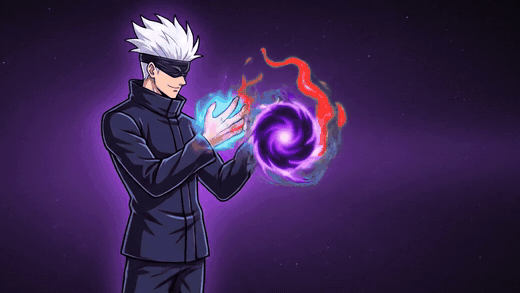

</div>

> 🚧 **Still under development.** Everything below is playable today, but expect rough edges, balance
> changes and new content. Feedback and bug reports are welcome. Open an issue!

---

## 📸 Screenshots

| | |
|---|---|
| 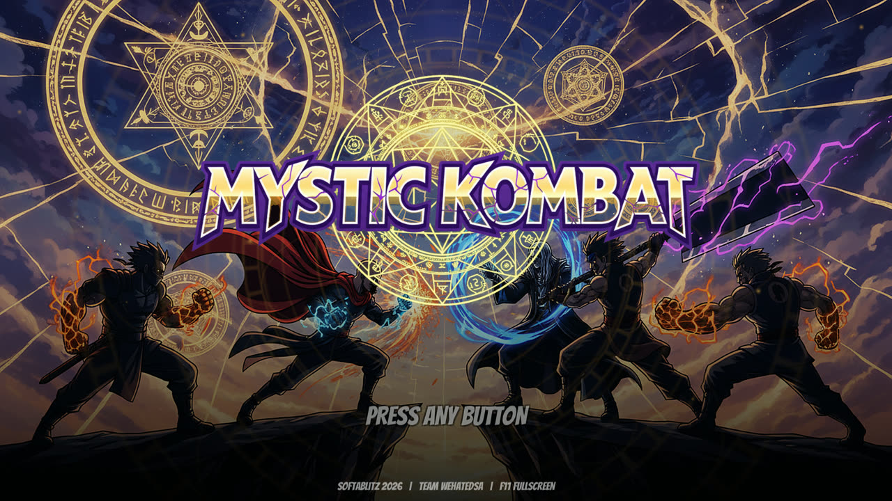 | 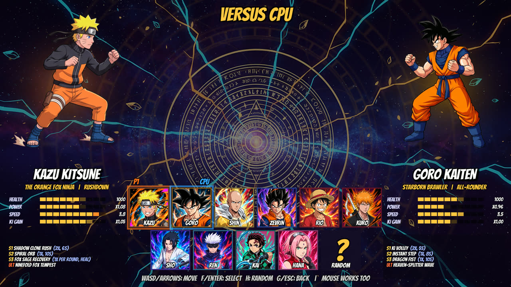 |
| 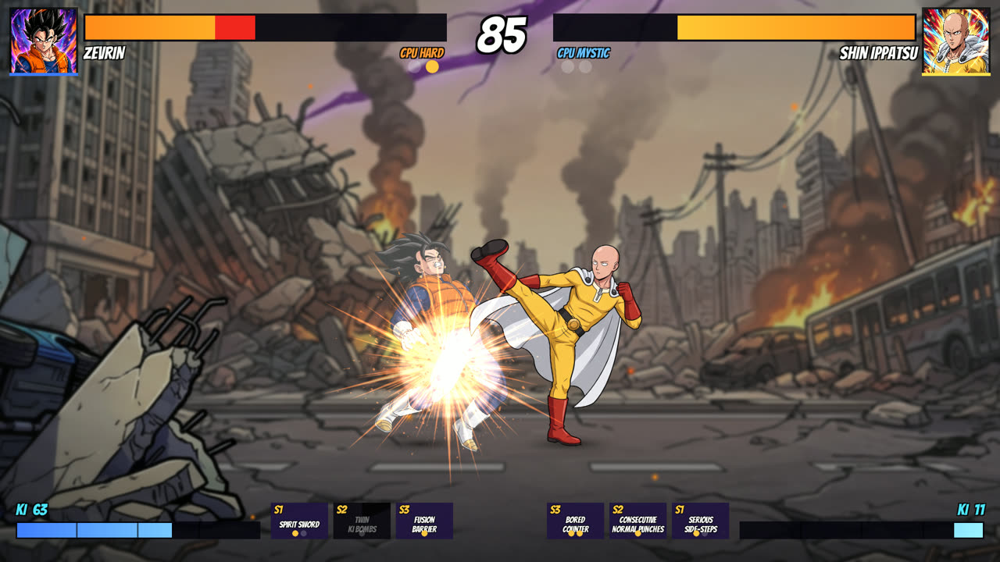 | 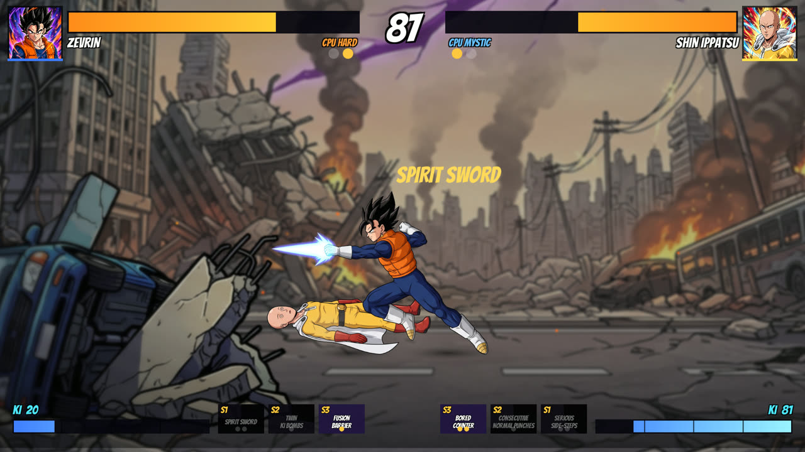 |
| 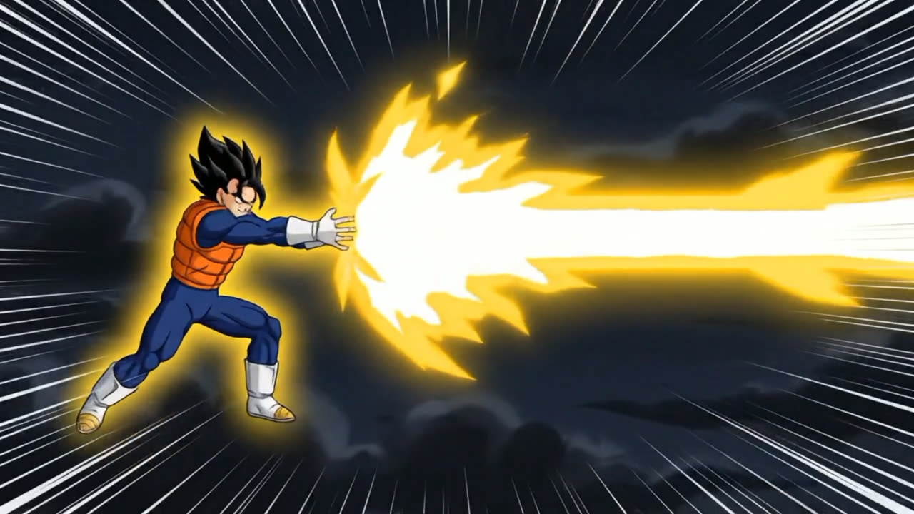 | 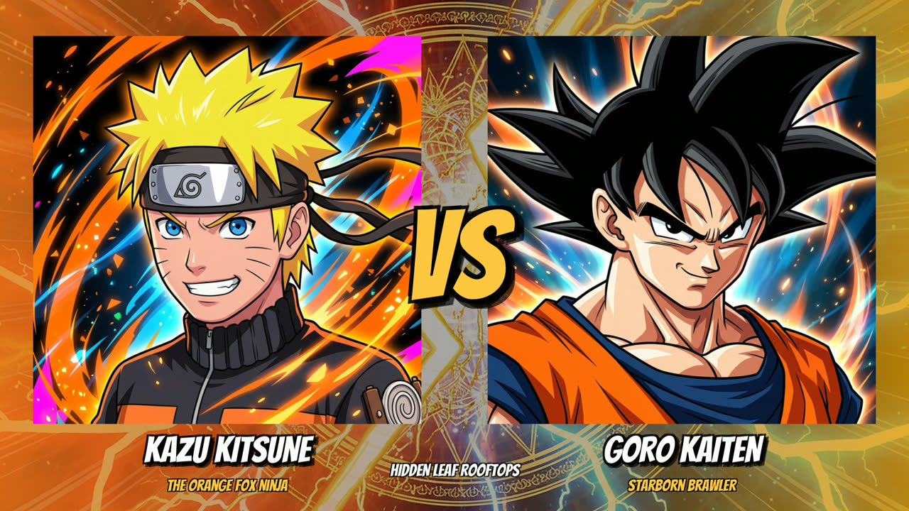 |
| 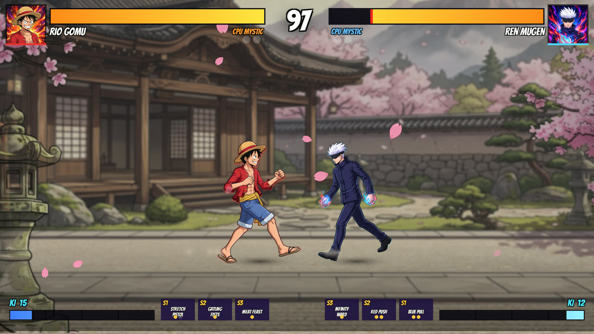 | 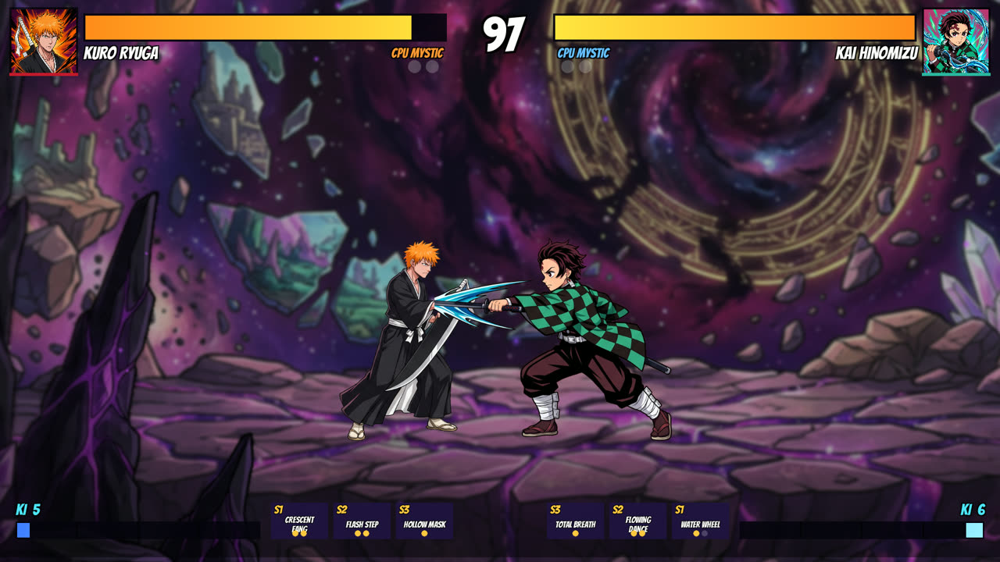 |
| 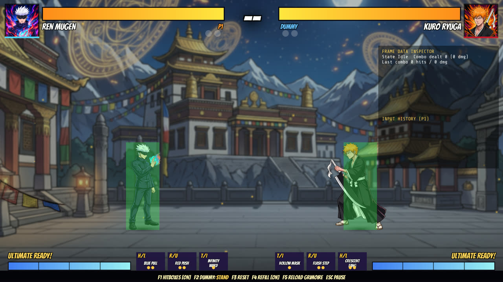 | 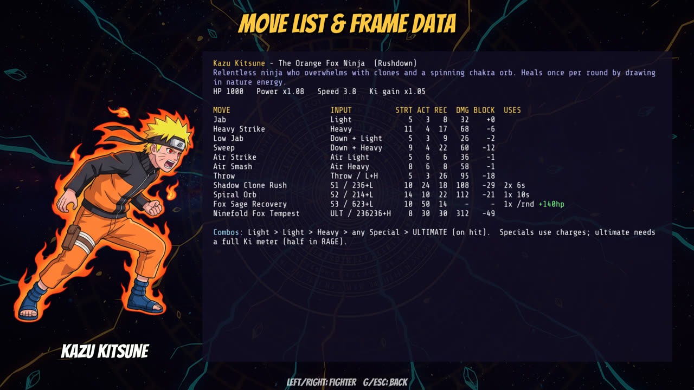 |

---

## ✨ Features

- **11 fighters** (10 playable + a secret boss), each with their own HP, power, speed, jump, defence and Ki gain.
- **3 special moves + 1 cinematic ultimate per fighter**: projectiles, teleports, counters, reflecting shields,
  armour buffs, heals and more.
- **Fully animated ultimate cutscenes** for every fighter, with super-freeze, name banner, camera zoom and slow motion.
- **Tekken / Street Fighter-style combat**:
  - light → light → heavy → special → ultimate cancel chains
  - combo counter with damage scaling and a juggle limit, so there are no infinites
  - throws and throw breaks
  - dashes and an invincible backdash
  - wall splats and knockdowns
  - high, low and overhead attacks
- **Motion inputs** (236 / 214 / 623 / 236236) with an 8-frame input buffer, plus one-button shortcuts.
- **Ability charges, tactical-shooter style**: every special has its own charges. Some recharge on a timer and
  some are once per round.
- **Ki meter and Rage**: Ki fills by dealing and taking damage, and Ki orbs drop mid-round. Below 25% HP you
  enter **Rage**: +12% damage and a half-price ultimate.
- **Japanese voice acting**: every fighter shouts their specials and ultimates, grunts when hit, screams on KO and
  taunts on victory, with P1 in the left speaker and P2 in the right. You can switch to English or turn voices off.
- **6 arenas** with parallax layers, ambient particles (leaves, petals, embers, sparks, void motes, dust) and a
  depth-of-field pass so the fighters always read clearly.
- **Original soundtrack** with 8 tracks, punchy SFX and a hype announcer.

## 🎮 Game modes

| Mode | Description |
|---|---|
| **Arcade** | 6-stage ladder: four rivals, a mirror match, then the boss. Scores are saved, and you can continue. Clear it to unlock the boss. |
| **Versus (2 players)** | Two players on one keyboard, or keyboard + gamepad. |
| **Versus CPU** | Fight the AI at **Easy / Normal / Hard / Mystic**. |
| **CPU vs CPU** | Sit back and watch two AIs fight. |
| **LAN Battle** | Online play over your local network, with host discovery or join by IP. |
| **Training** | Live hitboxes/hurtboxes, frame-data inspector, input history, 8 dummy behaviours, infinite Ki. |

## 🥋 Roster

| Fighter | Style | Specials | Ultimate |
|---|---|---|---|
| **Kazu Kitsune** · The Orange Fox Ninja | Rushdown | Shadow Clone Rush · Spiral Orb · Fox Sage Recovery *(heal)* | Ninefold Fox Tempest |
| **Goro Kaiten** · Starborn Brawler | All-rounder | Ki Volley · Instant Step · Dragon Fist | Heaven-Splitter Wave |
| **Shin Ippatsu** · The Caped Baldy | Powerhouse | Serious Side-Steps · Consecutive Normal Punches · Bored Counter | Serious Punch |
| **Zevrin** · The Fused Prince | Technical | Spirit Sword · Twin Ki Bombs · Fusion Barrier *(reflect)* | Final Fusion Flash |
| **Rio Gomu** · Rubber Pirate | Long-range brawler | Stretch Pistol · Gatling Fists · Meat Feast *(heal)* | Titan Fist |
| **Kuro Ryuga** · Soul Cleaver | Swordsman | Crescent Fang · Flash Step · Hollow Mask *(armour)* | Black Moon Crescent |
| **Sho Raikiri** · Lightning Avenger | Speed / counter | Chirping Blade · Fire Dragon Breath · Eye of Insight *(counter)* | Thunder Kirin |
| **Ren Mugen** · Infinity Sorcerer | Zoner | Blue Pull · Red Push · Infinity Ward *(shield + heal)* | Hollow Violet |
| **Kai Hinomizu** · Breathing Swordsman | Balanced | Water Wheel · Flowing Dance · Total Breath *(heal)* | Sun Dragon Dance |
| **Hana Sakuraba** · Cherry Blossom Medic | Bruiser / healer | Cherry Quake *(low)* · Healing Palm · Blossom Kunai | Hundred Healings Smash |
| 🔒 **Malgrath** · Void Emperor | Boss | Death Beam · Supernova · Psychic Lift | Planet Breaker |

## 🕹️ Controls

| Action | Player 1 | Player 2 | Gamepad |
|---|---|---|---|
| Move / jump / crouch | `W A S D` | Arrow keys | Stick / D-pad |
| Block | Hold away (down-away = low block) | Hold away | Hold away |
| Light / Heavy | `F` / `G` | `Num1` / `Num2` (or `,` `.`) | X / Y |
| Special 1 / 2 / 3 | `H` / `R` / `T` (or 236 / 214 / 623 + Light) | `Num3` / `Num4` / `Num5` | A / B / RB |
| Ultimate (full Ki) | `Y` (or 236236 + Heavy) | `Num6` | RT |
| Throw / break | `V` or Light + Heavy | `Num0` | LB |
| Dash / backdash | Double-tap forward / back | Double-tap | Double-tap |
| Pause | `Esc` | `Esc` | Start |

In single-player modes P1 can also use the arrow keys with `J K L` / `U I O`. Press `F11` to toggle fullscreen.

## 🚀 Getting started

### Play
Download the latest Windows build from **[Releases](../../releases)**, unzip it and run `MysticKombat.exe`.

### Build from source
1. Install **Unity 6000.6.7f1** (Unity Hub) with the Windows, Linux and/or Mac Build Support modules.
2. Clone this repo and open the folder in Unity Hub.
3. Build from the menu **Mystic Kombat → Build Windows / Linux / Mac**, or from the command line:
   ```sh
   tools/build.sh Windows     # or Linux / Mac / All  -> Builds/
   ```

### Custom voices (optional)
Drop `.ogg`, `.wav` or `.mp3` files into `MysticKombat_Data/StreamingAssets/voice_override/` and they replace
the built-in lines. Name each file after the line, for example `ren_ult.ogg` or `kazu_s2.wav`. The full list of
names is in [`voice_override/README.txt`](Assets/StreamingAssets/voice_override/README.txt). Files you add there
are git-ignored.

## 🧠 Under the hood

- **Deterministic simulation.** The whole battle runs in pure C# (`Assets/Scripts/Core`) at a fixed 60 Hz with no
  Unity dependency. The same inputs always produce the same result, verified by state checksums. One codebase
  drives local play, LAN lockstep and headless testing.
- **LAN netcode.** Delay-based lockstep over UDP (ports 47777–47778), with LAN host discovery and per-30-frame
  checksums to detect desyncs.
- **Adaptive CPU.** A finite-state-machine AI (neutral / approach / pressure / zone / defend / punish / recover).
  The higher difficulties track your habits (jump-ins, high/low mix, zoning, blocking) and counter them.
- **Data-driven fighters.** Every fighter, move and frame-data value lives in
  `Assets/StreamingAssets/grimoire/fighters.json` and loads at runtime. Press `F5` in Training to hot-reload it.
- **Balance testing.** A headless .NET harness (`tools/simtest`) plays thousands of CPU-vs-CPU matches to check
  win rates, auto-tune fighter power and verify determinism:
  ```sh
  cd tools/simtest
  dotnet run -c Release -- balance 12 3     # round-robin win-rate matrix
  dotnet run -c Release -- tune 10          # nudge fighter power toward 50%
  dotnet run -c Release -- determinism      # replay twice, compare checksums
  ```
- **Automated testing.** The game has an `-mkautotest` mode that screenshots every screen (`menus`), plays full
  CPU matches with an FPS report (`cpu N`) and runs a LAN host/client pair (`lanhost` / `lanclient`).
  `tools/playtest.py` drives the real game with OS-level key presses.

```
Assets/Scripts/Core      deterministic battle sim, fighter data loader, input buffer + motions, CPU brain
Assets/Scripts/Game      screens, battle rendering / VFX / camera, HUD, audio, input, LAN session, autotest
Assets/StreamingAssets   fighter + arena data (JSON), cutscene videos, voice overrides
Assets/Resources         fighter sprites, arenas, VFX, UI, music, SFX, voices, fonts
tools/                   build script, balance harness, playtest driver
```

## 🗺️ Roadmap

- [ ] More frames per animation (smoother walk cycles and attacks)
- [ ] Longer music loops
- [ ] Online play beyond LAN (rollback netcode)
- [ ] More fighters and stages
- [ ] Story mode
- [ ] Rebindable controls

## 🙏 Credits

- **Fonts:** [Bangers](https://fonts.google.com/specimen/Bangers) by Vernon Adams and
  [Share Tech Mono](https://fonts.google.com/specimen/Share+Tech+Mono), both under the SIL Open Font License 1.1.
- **Sound effects:** partly layered with CC0 recordings from *"100 CC0 SFX"* and *"80 CC0 RPG SFX"* by
  **rubberduck** ([OpenGameArt](https://opengameart.org/content/100-cc0-sfx)).
- Character art, arenas, cutscenes, music and voices were made for this project.

## ⚠️ Disclaimer

Mystic Kombat is a non-commercial **fan project**. Its characters are original designs affectionately inspired
by popular anime archetypes; it is not affiliated with or endorsed by any anime studio, publisher or rights
holder. All trademarks belong to their respective owners.
